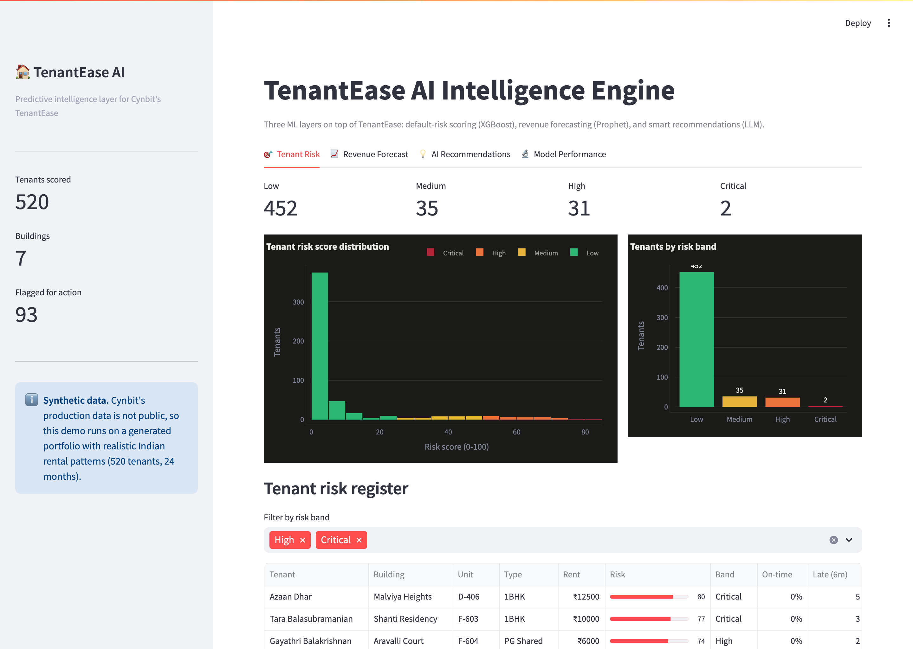
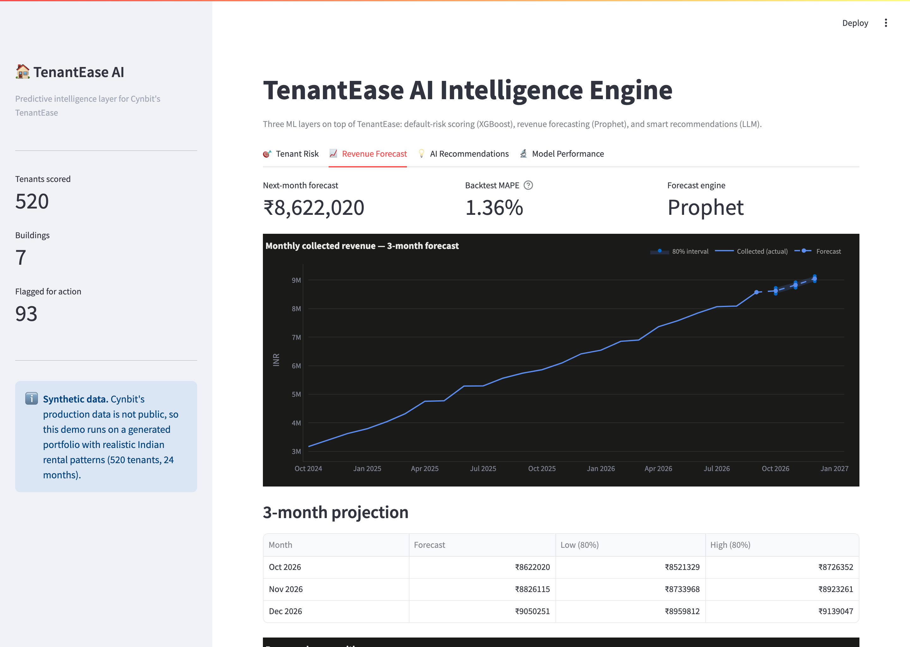
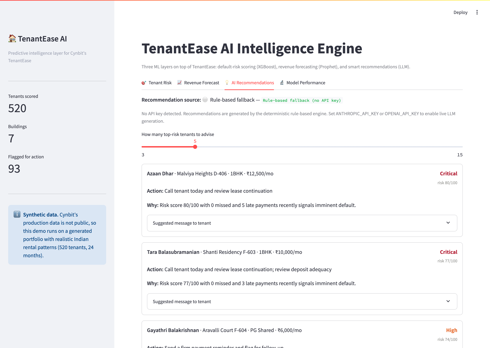
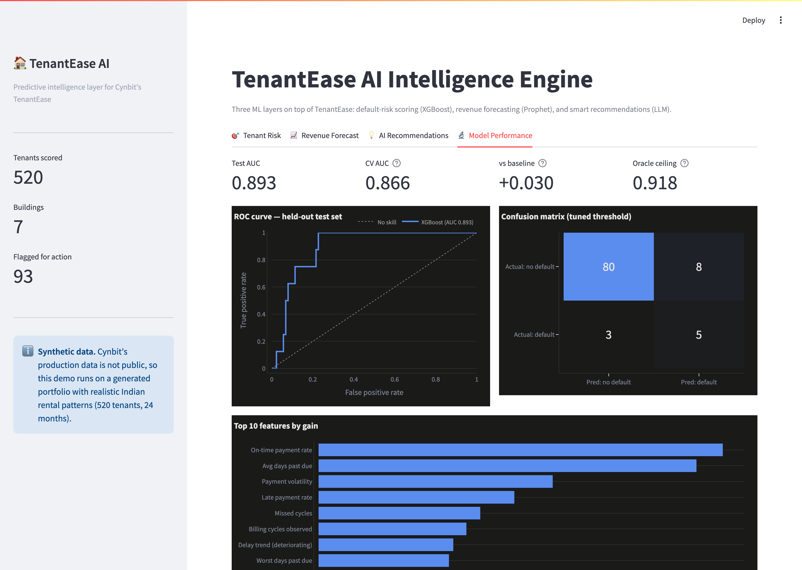

# TenantEase AI Intelligence Engine

**A predictive AI layer for Cynbit's TenantEase property-management platform.**

> AI/ML Engineer Intern assessment for [Cynbit Technologies](https://www.cynbit.in).
> Built as a proof of concept that turns TenantEase from a reactive record-keeper
> into a predictive decision-support product.

[](https://github.com/Krishnareddy2468/cynbit-tenantease-ai/actions/workflows/ci.yml)


---

## The problem

TenantEase tells landlords **what happened** — it tracks rent, records payments,
and fires calendar-based reminders. It cannot tell them **what will happen**.
This project adds three ML layers that make it predictive:

| Layer | Question answered | Technique | Result |
|---|---|---|---|
| 🎯 **Risk scoring** | *Who* is likely to default next quarter? | XGBoost classification | Test AUC **0.893** |
| 📈 **Revenue forecasting** | *What* will collection look like? | Prophet time series | Backtest MAPE **1.36%** |
| 💡 **Recommendations** | *What should the landlord do?* | LLM + rule-based fallback | Plain-English action per tenant |

Together they move TenantEase into whitespace no Indian competitor (RentOk,
ApnaComplex, Aeria) currently occupies: **prediction, not just tracking**.

---

## Dashboard

A four-tab Streamlit app ties the layers together.

| Tab | What it shows |
|---|---|
| 🎯 Tenant Risk | Score distribution, risk bands, filterable register, per-tenant drill-down |
| 📈 Revenue Forecast | 3-month forecast with confidence bands, trend/seasonal decomposition, MAPE |
| 💡 AI Recommendations | LLM (or rule-based) action cards per tenant, live/fallback provider badge |
| 🔬 Model Performance | ROC curve, confusion matrix, feature importance, baseline & oracle comparison |






---

## Quick start

```bash
# 1. install
python3.11 -m venv .venv
.venv/bin/pip install -r requirements.txt

# 2. generate data + train the risk model
.venv/bin/python scripts/generate_data.py
.venv/bin/python scripts/train.py

# 3. run the dashboard
.venv/bin/streamlit run app.py
```

The app runs with **no API key** — the recommendation engine falls back to a
deterministic rule-based generator. To enable live LLM recommendations, copy
`.env.example` to `.env` and set `ANTHROPIC_API_KEY` or `OPENAI_API_KEY`.

---

## Results

| Metric | Value | Note |
|---|---|---|
| Risk model — test AUC | **0.893** | Held-out 20%, never seen in training |
| Risk model — CV AUC | 0.866 ± 0.080 | 5-fold stratified |
| Logistic baseline (test) | 0.864 | XGBoost lift +0.030 |
| Oracle ceiling | 0.918 | Model sits **below** it → no label leakage |
| Recall @ tuned threshold | 0.625 | Catches most real defaulters |
| Revenue forecast — backtest MAPE | **1.36%** | 3-month held-out tail |
| Test suite | **34 passing** | Incl. temporal-leakage guard + no-key fallback |

---

## How it works

### Data
Cynbit's production data is not public, so the PoC generates a **synthetic
portfolio** (520 tenants, 7 buildings, 24 months, ~8,500 payment cycles) with the
same schema TenantEase stores and realistic Indian rental behaviour — collection
94.5%, on-time 71.5%. The generator is causal (a latent reliability trait drives
payment delays), so the model learns from noisy proxies, as it would in
production.

### No label leakage
The payment ledger is split on the **time axis**: features come from the
observation window (first 21 cycles), the label from the forward window (last 3).
A tenant is a default only with **2+ delinquent cycles** in that window — a
pattern, not one unlucky month. The disjoint split is enforced by a test, and the
model's AUC (0.893) sitting below the oracle ceiling (0.918) confirms no leakage.

### Graceful degradation
Every layer has a fallback so the demo never breaks:
- **Forecasting** → Holt-Winters if Prophet's backend is unavailable.
- **Recommendations** → rule-based generator if no API key or malformed LLM output.

See the [Technical Approach Report](docs/Technical_Approach_Report.md) for the
full methodology.

---

## Repository layout

```
cynbit-tenantease-ai/
├── app.py                      # Streamlit dashboard (4 tabs)
├── src/
│   ├── config.py               # central config: schema, thresholds, palette
│   ├── data_generator.py       # synthetic tenant + payment ledger
│   ├── features.py             # feature pipeline + temporal split
│   ├── risk_model.py           # Layer 1 — XGBoost risk classifier
│   ├── forecasting.py          # Layer 2 — Prophet + Holt-Winters fallback
│   ├── llm_client.py           # provider-agnostic LLM client
│   ├── recommendations.py      # Layer 3 — recommendation engine
│   └── ui.py                   # Plotly chart builders (dark theme)
├── scripts/                    # generate_data · train · forecast · recommend · build_docs
├── tests/                      # 34 tests across all layers
├── docs/                       # AI Opportunity + Technical Approach reports (md + pdf)
└── .github/workflows/ci.yml    # lint + test on push
```

---

## Documentation

- 📄 [AI Opportunity Report](docs/AI_Opportunity_Report.md) — industry analysis, opportunity selection, market & competitor data
- 📄 [Technical Approach Report](docs/Technical_Approach_Report.md) — architecture, model choices, data pipeline, prompt engineering, evaluation, production plan

---

## Limitations

This is a proof of concept on synthetic data — it demonstrates capability, not
production performance. A production deployment would retrain on real TenantEase
data, use daily collection history for forecasting, and add a fairness audit
before acting on scores. Details in the Technical Approach Report.

---

## Tech stack

Python 3.11 · XGBoost · Prophet · scikit-learn · Anthropic / OpenAI SDKs ·
Streamlit · Plotly · pandas · pytest
